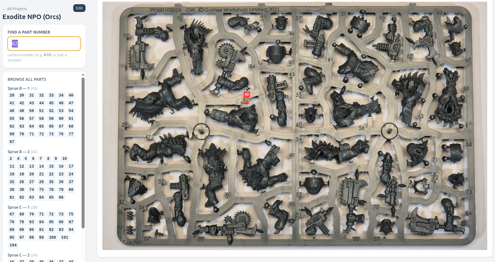
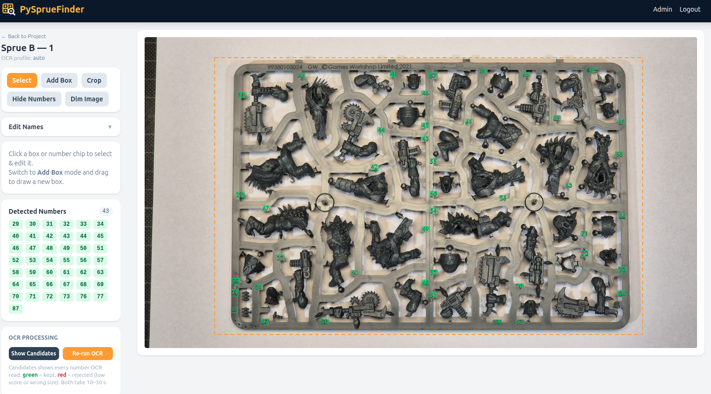
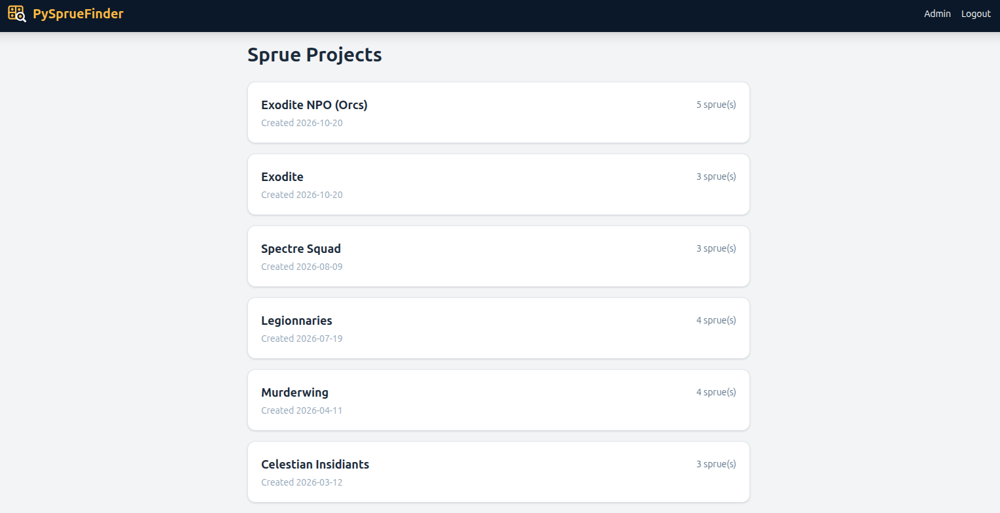

# PySprueFinder

A self-hosted web app for finding parts on Warhammer (and other plastic model kit) sprues. Photograph each
sprue once, let OCR find the part numbers moulded into the frame, then search for a part like `A12` or
`P197` and see exactly where it sits on the sprue.

> **Internal use only.** Authentication is a single shared admin password, there are no user accounts,
> no rate limiting and no TLS. Run it on a trusted home or lab network (or behind a VPN), never exposed
> to the internet. Viewing and searching sprues needs no login at all.

## Screenshots

**Find a part** — type a number (or sprue code + number) and the matching spot is highlighted on the
sprue photo. The list on the left shows every detected part per sprue.



**Edit a sprue** — detected numbers are drawn on the photo; add, fix or delete boxes, re-run OCR, and
set the display crop (dashed outline) that search results zoom in on.



**Projects** — one project per kit, each with any number of sprues.



## Features

- Projects (kits) with any number of sprues, each identified by a code such as `A` or `P1`
- Automatic detection of the part numbers on an uploaded sprue photo
- Search by sprue code + part number (`A12`, `P197`) or by number alone across all sprues
- Matches highlighted directly on the sprue photo; browse all detected parts per sprue
- Admin editor to add, fix or delete detections, plus an OCR candidate view to see what was read
- Optional display crop per sprue, so search results zoom in on the sprue (the photo stays unchanged)
- SQLite storage, no external services; OCR models are bundled, so it works fully offline

## Quick start

```bash
cp .env.example .env
# edit .env: set ADMIN_PASSWORD and SECRET_KEY

docker compose -f docker-compose.example.yml up -d
```

Then open [http://localhost:8000](http://localhost:8000), log in via **Admin Login**, create a project and
upload a photo per sprue.

Images are published to `ghcr.io/oxivanisher/pyspruefinder` for `linux/amd64` and `linux/arm64`.
The page footer shows the git commit the running image was built from, so you can check which version
you have. The example compose file includes an optional [Watchtower](https://containrrr.dev/watchtower/)
service that pulls new images automatically.

To build from source instead, use `docker compose up -d --build`.

## Configuration

Set via environment variables (or `.env`):

| Variable | Default | Description |
|----------|---------|-------------|
| `ADMIN_PASSWORD` | `changeme` | Shared admin password — change it |
| `SECRET_KEY` | random per start | Signs the session cookie; set it, or admins are logged out on every restart |
| `DATABASE_URL` | `sqlite:///./instance/spruefinder.db` | SQLAlchemy database URL |
| `UPLOAD_DIR` | `./uploads` | Where sprue photos are stored |
| `OCR_MIN_SCORE` | `0.7` | Minimum recogniser confidence for a detection |
| `OCR_FONT_SIZE_TOLERANCE` | `0.35` | How far a detection's height may deviate from the dominant label height |

Persist `/app/instance` (database) and `/app/uploads` (photos) as volumes.

## Taking good sprue photos

- Photograph the whole sprue flat, from straight above, filling most of the frame
- Even lighting without hard reflections; a plain light background works well
- Full phone-camera resolution is fine (uploads are scaled to max 4000 px)

On such photos OCR finds about 95% of the numbers. Typical misses are tilted single digits and numbers
partly hidden by the frame edge; add those in the editor with **Add Box**. Processing takes roughly
10–30 seconds per photo depending on the CPU and needs about 1 GB of RAM.

## How the OCR works

[RapidOCR](https://github.com/RapidAI/RapidOCR) (PaddleOCR PP-OCRv4 models on ONNX Runtime) runs a coarse
pass at native resolution to measure how large the labels are, then a tiled pass upscaled so the labels
are about 100 px tall, which also catches the thin, low-contrast numbers moulded directly into the frame.
Results are merged and filtered by confidence and label size. See `app/ocr.py` for details.

## Development

```bash
python3.12 -m venv .venv
.venv/bin/pip install -r requirements.txt
cp .env.example .env
.venv/bin/python run.py   # http://localhost:8000 with hot reload
```

The CSS is generated by the [Tailwind v3 standalone CLI](https://github.com/tailwindlabs/tailwindcss/releases/tag/v3.4.17)
(the Docker build does this automatically). For local development, download it once (use the
`linux-arm64`/`macos-*` asset as appropriate) and keep it rebuilding in a second terminal:

```bash
curl -fsSLo tailwindcss https://github.com/tailwindlabs/tailwindcss/releases/download/v3.4.17/tailwindcss-linux-x64
chmod +x tailwindcss
./tailwindcss -c tailwind/tailwind.config.js -i tailwind/input.css -o app/static/css/tailwind.css --watch
```
